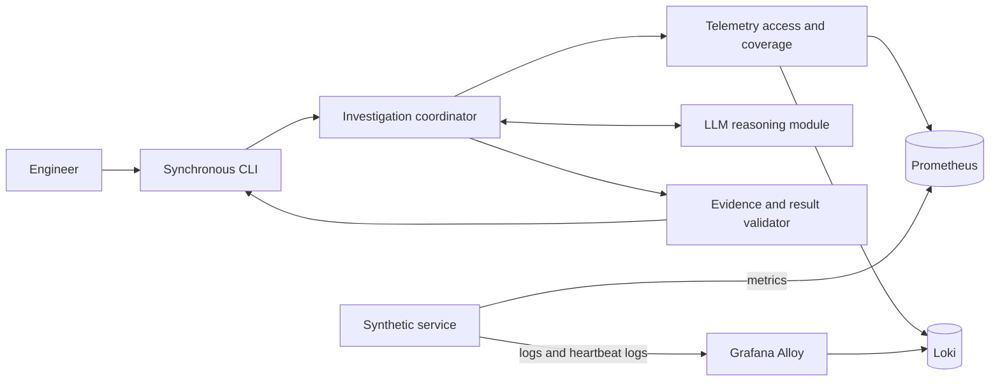

# Incident Agent V1 architecture

Status: Accepted architectural direction. The unresolved implementation choices below remain open.

## Purpose and authority

V1 validates the smallest useful end-to-end investigation: an engineer reports an unhealthy named service, and the agent inspects that service's logs and metrics to return an evidence-backed analysis. This document applies the [V1 requirements](../product/v1-requirements.md) and accepted decisions [001](decisions/001-v1-investigation-scope.md), [002](decisions/002-telemetry-stack.md), [003](decisions/003-data-security-boundary.md), [004](decisions/004-invocation-model.md), and [005](decisions/005-evaluation-strategy.md). Decisions [006](decisions/006-agent-query-control.md), [007](decisions/007-log-coverage-strategy.md), [008](decisions/008-service-identity-and-time.md), [009](decisions/009-application-stack.md), and [010](decisions/010-investigation-result-semantics.md) record the approved architecture review.

V1 is manually initiated, synchronous, read-only, single-user, and single-tenant. It investigates one service within an engineer-supplied bounded time window using synthetic/local telemetry only. Dependencies, other services, deployment events, automatic detection, and executed remediation are outside V1. The agent may recommend remediation when evidence supports it, but cannot perform it.

## High-level architecture

Grafana may help a person inspect telemetry but is not in the agent's query path. The agent calls Prometheus and Loki directly. The application uses Node.js and TypeScript and the OpenAI API through its official SDK, without an agent framework. Provider-specific behavior stays inside the LLM reasoning module; the exact model is deferred to synthetic-scenario evaluation. See [ADR 002](decisions/002-telemetry-stack.md) and [ADR 009](decisions/009-application-stack.md).

## Modules and responsibilities

| Module | Responsibility and interface |
| --- | --- |
| CLI | Accept the service and investigation time window, resolve the environment to `local` by default, display that resolved value, show progress, and render the final structured result. The investigation behavior does not depend on the CLI. |
| Investigation coordinator | Own one synchronous run, its transient state, query ledger, bounds, stop conditions, and failure handling. It validates a suggested query intent before any telemetry call. |
| Prometheus access | Construct and execute bounded metric queries for the named service and environment; return normalized series, aggregation context, sample coverage, warnings, and errors. |
| Loki access | Construct and execute bounded log queries for the named service and environment; return normalized entries, query context, result-limit information, warnings, and errors. |
| Coverage assessment | Assess metric sample/scrape availability and log heartbeat/collection evidence over the requested interval. Report `available`, `partial`, `absent`, or `unknown` with reasons; never equate missing telemetry with healthy behavior. |
| Evidence ledger | Keep retrieved, run-local evidence and query provenance in memory so observations, hypotheses, and citations can be checked against what was actually queried. No persisted investigation job is created. |
| LLM reasoning | Analyze bounded evidence, form and revise hypotheses, consider counterevidence, suggest only supported query intents, and draft the structured analysis. It has no direct backend or remediation access. |
| Result validation | Check structural validity and evidence references against the ledger. It does not certify that a cited fact proves a causal claim. |

These are logical modules, not prescribed classes or package names. Prometheus and Loki keep distinct query interfaces because their result and filtering semantics differ. The coordinator sees normalized outcomes while the access modules retain source warnings and query provenance.

## Investigation flow and control

1. **Request and context.** The engineer supplies a named service and time window through the CLI. The CLI resolves the environment, displaying `local` when the default is used. Timestamps are normalized to UTC; the internal investigation interval is half-open, `[start, end)`. The coordinator rejects an invalid interval or a request outside its configured bounds before querying. See [ADR 008](decisions/008-service-identity-and-time.md).
2. **Coverage assessment.** Before interpreting a filtered result, the coordinator checks expected metric samples and scrape information and looks for the synthetic service's periodic heartbeat logs. Collector/pipeline health provides additional coverage evidence. A missing heartbeat can indicate a logging gap or a service that did not emit; it does not by itself establish service health. Coverage may remain `unknown`. See [ADR 007](decisions/007-log-coverage-strategy.md).
3. **Initial evidence.** The coordinator requests compact, aggregated metric trends and bounded, service-scoped log counts or samples for the requested window. If latency or error-rate metrics are unavailable, that absence is recorded as a data gap. No raw telemetry dump is loaded up front.
4. **Interpretation.** The LLM receives the request context, coverage assessment, and selected evidence. It separates observations from hypotheses, identifies supporting and contradictory evidence, and may propose a supported next query intent with a reason.
5. **Progressive query.** The coordinator checks the suggested intent against the service/environment scope, requested window, supported intent catalog, remaining query count, result-volume and runtime bounds. Only then does it construct a Prometheus or Loki query. Narrowing or expansion stays within the engineer's window. An unsupported investigation is recorded as a limitation; the model cannot submit arbitrary PromQL or LogQL. See [ADR 006](decisions/006-agent-query-control.md).
6. **Stop.** Stop when the evidence supports an assessment, no further supported query is justified, or an explicit bound or required source failure prevents useful continuation. Reaching a bound never forces a cause. If the named service's telemetry cannot support a conclusion, `insufficient evidence` remains a valid conclusion.
7. **Result.** Produce a structured analysis with observations, hypotheses, supporting evidence, counterevidence when present, data gaps, next investigation steps, and evidence-supported remediation recommendations. Validate every evidence reference against the run's ledger. Keep investigation `completeness` separate from `conclusion`. See [ADR 010](decisions/010-investigation-result-semantics.md).

Application logic owns scope, coverage checks, backend query construction, budget enforcement, stopping, provenance, and structural/reference validation. The LLM owns interpretation, hypothesis formation and revision, relevance judgments, and suggestions among supported next query intents. Synthetic incident scenarios assess whether those judgments are actually grounded, as required by [ADR 005](decisions/005-evaluation-strategy.md).

## Logical contracts

These contracts describe information and invariants; they do not prescribe TypeScript types or an implementation-level class layout.

| Contract | Required meaning |
| --- | --- |
| Investigation request | Named `service`, resolved `environment`, and timezone-aware start/end. Internally the window is UTC `[start, end)`. Any reported symptom is context, not permission to query other services. |
| Query intent | Signal, purpose, requested subwindow, supported filter or aggregation parameters, and justification. It cannot contain a free-form backend query to execute. |
| Query outcome | Backend, actual query scope, duration, returned results, warning/error state, and possible truncation or partial-result indication. A successful transport response does not imply complete data. |
| Metric result | Metric identity, aggregation and unit where known, time resolution, bounded series/points, and sample-coverage information. |
| Log result | Source timestamp, service/environment, severity and relevant fields when present, bounded message excerpt, and stream/query provenance. Heartbeat entries are coverage evidence. |
| Telemetry coverage | Per-signal state (`available`, `partial`, `absent`, `unknown`), assessed interval, supporting checks, and limitations. Coverage is distinct from service health. |
| Evidence | Run-local identifier, source, observation or excerpt, time or interval, originating query, and completeness warnings. |
| Hypothesis | Proposed cause, supporting and counterevidence references, and what remains unverified. A structural citation is not proof of causal correctness. |
| Progress | Current investigation phase and material progress or warnings, shown while the synchronous CLI remains open. |
| Final incident analysis | Separate `completeness` and `conclusion`, plus request context, coverage, observations, hypotheses, linked evidence, gaps, next investigation steps, and supported remediation suggestions. |

The exact field names, allowed enum values beyond the approved coverage states, and serialization/rendering details remain implementation choices to validate against the synthetic scenarios. No numeric query or runtime limits are established by this document.

## Failure and partial-failure behavior

| Condition | Required handling |
| --- | --- |
| Prometheus unavailable | Record metric coverage as unknown, preserve the source error, and use available Loki evidence only within the same bounds. Do not infer normal metrics. |
| Loki unavailable | Record log coverage as unknown, preserve the source error, and use available Prometheus evidence only within the same bounds. Do not infer log silence. |
| Both telemetry sources unavailable | Report an incomplete or failed investigation, not a completed `insufficient evidence` analysis. |
| OpenAI request fails, is unavailable, or yields unusable output | Preserve validated factual findings and gaps if available; identify analysis as unavailable rather than fabricating hypotheses. |
| Query timeout | Record the timed-out query. A narrower retry may occur only if supported and within the remaining bounds; otherwise report the gap. |
| Excessive results | Enforce the result budget, record possible truncation, and narrow any further query. Returned-result limits do not alone limit backend scan cost. |
| Partial results or warnings | Preserve warnings with affected evidence and limit conclusions accordingly. |
| Missing telemetry or unestablished coverage | Mark coverage absent or unknown as justified by checks. Neither state means the service is healthy. |
| No relevant evidence | Conclude `insufficient evidence` only when investigation completeness supports that reading; otherwise report incompleteness. |
| Conflicting evidence | Include counterevidence, weaken or revise hypotheses, and make another supported query only when justified and within bounds. |
| Investigation bounds reached | Stop, report the bound and untested possibilities, and do not force a definitive cause. |

`Completeness` describes how much of the permitted investigation could be performed; `conclusion` describes what the available evidence supports. A completed investigation with insufficient evidence differs from an incomplete investigation caused by a backend, model, or budget limit. See [ADR 010](decisions/010-investigation-result-semantics.md).

## Data and safety boundaries

Only synthetic/local telemetry is permitted. V1 is single-user and single-tenant. Raw synthetic telemetry may be sent to the configured managed LLM without application-level redaction. This does not make V1 suitable for real customer or production telemetry. The coordinator exposes read-only, scoped telemetry queries to the reasoning module and no remediation operations. Local API keys remain outside source control; `.env` must be ignored by Git before it holds a real key. See [ADR 003](decisions/003-data-security-boundary.md).

## Assumptions, compromises, and risks

- The synthetic service emits suitable latency/error metrics and structured logs with consistent service and environment identity. If it does not, the agent reports gaps instead of substituting guesses.
- Heartbeats and pipeline health strengthen log-coverage assessment but cannot prove complete delivery of every log event. An `unknown` coverage result is valid.
- Query intents trade some flexibility for inspectable scope and deterministic limits. Unsupported investigations are explicit limitations.
- The model can return a well-formed but causally weak claim. Ledger validation checks references, while representative synthetic scenarios evaluate relevance, uncertainty, and counterevidence handling.
- A synchronous CLI blocks for the investigation duration, and in-memory evidence is unavailable after the process exits. This follows the accepted V1 invocation model.
- Loki is less suitable for broad arbitrary full-text search than an indexed search system; V1 begins with a known service and bounded window.

## Unresolved implementation choices

These are **not approved by this document**: numeric query-count, time-range, result-volume, and runtime limits; the exact supported-intent catalog and query templates; heartbeat cadence and coverage thresholds; metric names and log field schema; the exact OpenAI model; final result enum names and CLI exit/rendering conventions. They should be specified and checked against synthetic scenarios during later design refinement or implementation planning without changing ADRs 001–010. Any choice that materially changes an approved boundary needs review.

## Deferred capabilities and evolution

V1 does not investigate dependencies, other services, traces, or deployment events; detect incidents automatically; execute remediation; or persist background jobs. Web/REST/chat interfaces, Slack/Teams integration, production telemetry and governance, multi-tenancy, CloudWatch-native telemetry, OpenSearch-style log search, and distributed telemetry scaling remain deferred under ADRs 001–005. The CLI-independent investigation coordinator and provider-specific reasoning module provide places to introduce later interfaces and model providers without placing them in V1 scope.
